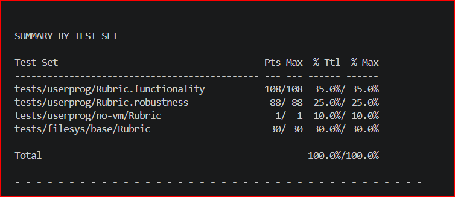

		     +--------------------------+
       	     |		CS 2043		        |
		     | PROJECT 2: USER PROGRAMS	|
		     | 	   DESIGN DOCUMENT     	|
		     +--------------------------+

---- GROUP ----

>> Fill in the names and email addresses of your group members.

Oshada Dilvan Jayasinghe
240279C
<oshada.24@cse.mrt.ac.lk>

---- PRELIMINARIES ----

>> If you have any preliminary comments on your submission, notes for the
>> TAs, or extra credit, please give them here.



>> Please cite any offline or online sources you consulted while
>> preparing your submission, other than the Pintos documentation, course
>> text, lecture notes and course staff.

<https://pkuflyingpig.gitbook.io/pintos/project-description/lab2-user-programs>

			   ARGUMENT PASSING
			   ================

---- DATA STRUCTURES ----

>> A1: Copy here the declaration of each new or changed `struct' or
>> `struct' member, global or static variable, `typedef', or
>> enumeration.  Identify the purpose of each in 25 words or less.

No new structs or global variables were added specifically for argument passing.
Modified the signature of stack setup helper `setup_stack()` in `userprog/process.c`:

```c
static bool setup_stack (void **esp, const char *cmdline);
```

*Purpose:* Tokenizes the command line string and builds the x86 user stack frame. `argv[128]` serves as local storage capacity inside setup_stack(), not an explicitly checked limit.

---- ALGORITHMS ----

>> A2: Briefly describe how you implemented argument parsing.  How do
>> you arrange for the elements of argv[] to be in the right order?
>> How do you avoid overflowing the stack page?

1. In `process_execute()`, I copy `file_name` into `prog_name` and parse the first token using `strtok_r()` to extract the executable binary name for `thread_create()`.
2. In `setup_stack()` I copy the `cmdline` string into a local buffer `cmdline_copy[128]` using `strlcpy()`. Note that `strlcpy()` silently truncates command lines longer than 127 characters. (`load()` similarly copies the command line into `prog_name[128]` to extract the executable name, so it truncates at the same length.)
3. I tokenize the string left-to-right with `strtok_r()`. As each argument token is extracted, I push its string bytes onto the user stack (decrementing `*esp`) and store its virtual address in a local array `argv[argc]`. `argv[128]` is local array capacity. in practice, the 128 byte copied command line buffer incidentally limits token count before the array could fill.
4. I round down `*esp` using `*esp=(void*)((uintptr_t)*esp & ~3)` to satisfy the 4 byte alignment requirement.
5. I push a NULL pointer sentinel onto the user stack to terminate the vector. I then iterate backward through `argv` from `argc - 1` down to `0` and push each saved pointer onto the stack. This places `argv[0]` at the lowest virtual address.
6. I push the start address of `argv[0]`, followed by `argc` and a dummy 4 byte return address.

**Stack Overflow Prevention:** Command line length is restricted by the fixed parsing buffer (`char cmdline_copy[128]`). The total volume placed on the stack remains well under the 4 KB page limit (`PHYS_BASE-PGSIZE`).

---- RATIONALE ----

>> A3: Why does Pintos implement strtok_r() but not strtok()?

`strtok()` stores its internal string parsing state in a global static pointer, which is not threadsafe. If multiple kernel threads parse strings simultaneously, `strtok()` will corrupt the state. Pintos implements `strtok_r(),` which requires an explicit user allocated state pointer (`save_ptr`), making it reentrant and safe for multithreaded kernels.

>> A4: In Pintos, the kernel separates commands into a executable name
>> and arguments.  In Unix-like systems, the shell does this
>> separation.  Identify at least two advantages of the Unix approach.

1. String parsing happens in user space, reducing kernel code complexity and avoiding unnecessary kernel page allocations for string operations.
2. User shells can perform wildcard expansion (`*`), variable substitution (`$VAR`) and I/O redirection (`>`, `<`) before calling `exec()`, giving users more control without overloading the kernel.

			     SYSTEM CALLS
			     ============

---- DATA STRUCTURES ----

>> B1: Copy here the declaration of each new or changed `struct' or
>> `struct' member, global or static variable, `typedef', or
>> enumeration.  Identify the purpose of each in 25 words or less.

**In `threads/thread.h`:**

```c
extern struct lock filesys_lock;

struct file_descriptor{
   int fd;
   struct file *file;
   struct list_elem elem;
};

struct child_process
  {
    tid_t pid;
    int exit_status;
    bool loaded;
    bool has_waited;
    bool orphan;
    struct semaphore sema_load;
    struct semaphore sema_wait;
    struct list_elem elem;
  };
```

**Added to `struct thread` in `threads/thread.h`:**

```c
    int exit_status;

#ifdef USERPROG
    /* Owned by userprog/process.c. */
    uint32_t *pagedir;                  /* Page directory. */
    
    struct list fd_list;
    int next_fd;
    struct file* exec_file;
    
    struct list children;
    struct child_process* cp;
#endif
```

>> B2: Describe how file descriptors are associated with open files.
>> Are file descriptors unique within the entire OS or just within a
>> single process?

File descriptors are associated with open files via a process specific linked list `fd_list` contained in `struct thread`. Each entry is a dynamically allocated `struct file_descriptor` holding an integer `fd` and a pointer to a `struct file`.

File descriptors are unique only within a single process. each process manages its own independent `fd_list` and `next_fd` integer counter starting from descriptor 2(0 and 1 are reserved for `STDIN` and`STDOUT`)

---- ALGORITHMS ----

>> B3: Describe your code for reading and writing user data from the
>> kernel.

Before performing any memory access, user pointers are validated in `userprog/syscall.c` using `validate_buffer()` and `validate_string()`. They verify that pointers are non NULL, reside in user space (`is_user_vaddr`) and correspond to valid mapped physical pages (`pagedir_get_page`).

- **`SYS_READ`:** If `fd==0`, I read characters sequentially using `input_getc()`. If `fd>1`, I locate the matching `file_descriptor,` acquire `filesys_lock`, call `file_read()` and release the lock.
- **`SYS_WRITE`:** If `fd==1`, I output data to the console using `putbuf()`. If `fd>1`, I retrieve the file descriptor, acquire `filesys_lock`, call `file_write()` and release the lock. Attempting to write to denied executable files returns `0` bytes written because `load()` calls `file_deny_write()` on the executable and `file_write()` honors it.

>> B4: Suppose a system call causes a full page (4096 bytes) of data
>> to be copied from user space into the kernel.  What is the least
>> and the greatest possible number of inspections of the page table
>> (e.g. calls to pagedir_get_page()) that might result?  What about
>> for a system call that only copies 2 bytes of data?  Is there room
>> for improvement in these numbers and how much?

**Current Implementation:**
In my current implementation, `validate_buffer()` iterates over every byte individually, calling `pagedir_get_page()` for each byte:

- **4096 byte Buffer:** Performs 4096 pagetable inspections on a fully valid page (or fewer if an invalid byte triggers early exit via `sys_exit(-1)`).
- **2 byte Buffer:** Performs 2 pagetable inspections on valid memory.

**Theoretical Minimum/Maximum Page Inspections:**

- **4096 byte Buffer:** Minimum 1 inspection (if page aligned); Maximum 2 inspection (if straddling two pages)
- **2 byte Buffer:** Minimum 1 inspection (if both bytes reside on same page), Maximum 2 inspection (if straddling page boundary)

**Room for Improvement:** `validate_buffer()` can be optimized to check page boundaries (`pg_round_down`) rather than individual bytes. This would reduce page table lookup count from 4096 down to 1 or 2 calls for full page transfers.

>> B5: Briefly describe your implementation of the "wait" system call
>> and how it interacts with process termination.

1. In `process_wait()`, the parent checks its `children` list for a `child_process` matching `child_tid`. If found and `has_waited==false`, it sets `has_waited=true` and blocks on `sema_down(&cp->sema_wait)`.
2. When the child terminates in `process_exit()`, it records `cp->exit_status=cur->exit_status`. If its parent is alive (`cp->orphan==false`), it calls `sema_up(&cp->sema_wait)` to wake the parent.
3. The parent wakes up, reads `cp->exit_status`, removes `cp` from `cur->children` and frees `cp`.
4. If the parent terminates first, it iterates over all remaining child records in `cur->children` and sets `child->orphan=true`.

>> B6: Any access to user program memory at a user-specified address
>> can fail due to a bad pointer value.  Such accesses must cause the
>> process to be terminated.  System calls are fraught with such
>> accesses, e.g. a "write" system call requires reading the system
>> call number from the user stack, then each of the call's three
>> arguments, then an arbitrary amount of user memory and any of
>> these can fail at any point.  This poses a design and
>> error-handling problem: how do you best avoid obscuring the primary
>> function of code in a morass of error-handling?  Furthermore, when
>> an error is detected, how do you ensure that all temporarily
>> allocated resources (locks, buffers, etc.) are freed?  In a few
>> paragraphs, describe the strategy or strategies you adopted for
>> managing these issues.  Give an example.

Memory validation is separated from system call handlers using centralized validation helpers (`validate_buffer()` and`validate_string()`). At the start of every system call handler in `syscall_handler()`, stack pointers, arguments and buffer parameters are validated before work is performed or resources are allocated.

If a bad pointer is encountered, the helper directly kills the process via `sys_exit(-1)`. Because validation happens prior to acquiring locks or allocating heap memory, system call handlers do not require complex error-unwinding paths.

If process termination is triggered, `process_exit()` cleans up file descriptors, executable file state, page directories and most child process state, but does not free an already exited, unwaited child record when the parent exits.

*Example:* In `SYS_WRITE`, `validate_buffer(f->esp+4,3*sizeof(int))` validates stack arguments and `validate_buffer(buffer,size)` validates the payload buffer. If `buffer` is invalid, `sys_exit(-1)` is invoked before `lock_acquire(&filesys_lock)` is executed, preventing lock leaks.

---- SYNCHRONIZATION ----

>> B7: The "exec" system call returns -1 if loading the new executable
>> fails, so it cannot return before the new executable has completed
>> loading.  How does your code ensure this?  How is the load
>> success/failure status passed back to the thread that calls "exec"?

1. In `process_execute()`, the parent allocates a `child_process` structure with `sema_load` initialized to 0.
2. The parent creates the child thread using `thread_create()`, appends `cp` to `cur->children` and calls `sema_down(&cp->sema_load` to block until loading completes. The `SYS_EXEC` handler holds `filesys_lock` for the whole duration of `process_execute()`, including this wait.
3. The implementation relies on the child finding the parent’s newly inserted `cp` structure when `start_process()` scans `all_list`. The semaphore `sema_load` synchronizes loading only after the child process record has been discovered. **Known race:** because `cp` is appended only after `thread_create()` returns, the child can run first (for example if it preempts the parent). In that case the child does not find `cp`, leaves `cur->cp` as `NULL`, never calls `sema_up(&sema_load)` and the parent blocks forever. A safer design would append `cp` before `thread_create()` and pass it to the child through the `aux` argument
4. The child thread executes `load()`, sets `cur->cp->loaded=success` and unblocks the parent with `sema_up(&cur->cp->sema_load)`.
5. The parent wakes up in `process_execute().` If `cp->loaded==true`, it returns `tid`. If `cp->loaded==false`, it removes `cp`, frees it and returns `-1` (`TID_ERROR`). **Known race:** on load failure the child still reaches `process_exit()` after `sema_up(&sema_load)` and `process_exit()` dereferences `cur->cp`. If the parent has already freed `cp`, this is a use-after-free. It is usually hidden because the child normally reaches `process_exit()` before the parent runs, but a context switch in between can expose it.

>> B8: Consider parent process P with child process C.  How do you
>> ensure proper synchronization and avoid race conditions when P
>> calls wait(C) before C exits?  After C exits?  How do you ensure
>> that all resources are freed in each case?  How about when P
>> terminates without waiting, before C exits?  After C exits?  Are
>> there any special cases?

- P blocks on `sema_down(&cp->sema_wait)`. When C exits, it signals `sema_up(&cp->sema_wait)`. P unblocks, reads `cp->exit_status`, removes `cp` from `cur->children` and calls `free(cp)`.
- C writes `exit_status` to `cp` and calls `sema_up(&cp->sema_wait)` at exit. When P calls `process_wait()` later, `sema_down()` returns without blocking. P reads `exit_status`, removes `cp` and frees `cp`.
- In `process_exit()`, P marks all remaining records in `cur->children` with `orphan=true`. When C exits later, it detects `cp->orphan==true` and frees `cp` itself.
- When C exits, its `cp` remains in P's `children` list. When P exits later without calling `wait()`, `process_exit()` sets `child->orphan=true` on that node but does not free it because C has already exited. The current implementation leaves this `child_process` allocation unreleased unless P calls `wait()`.
- The check of `cp->orphan` in C's `process_exit(` and the setting of `orphan=true` in P's `process_exit()` are not atomic. If P sets `orphan` just after C has read it as `false`, C calls `sema_up()` and nobody frees `cp`, which leaks it (same effect as the case above).
- Repeated `wait(C)` calls or waiting on non child PIDs return `-1` immediately because `cp` is absent or has `has_waited==true`.

---- RATIONALE ----

>> B9: Why did you choose to implement access to user memory from the
>> kernel in the way that you did?

I chose explicit pointer verification using `pagedir_get_page()` because it is straightforward to write, test and debug. It prevents most kernel page fault exceptions during system calls and keeps kernel logic clean and predictable without requiring complex exception handling frame recovery. Limitation: `pagedir_get_page()` only checks that a page is mapped, not that it is writable, so a `read()` into a read-only user page passes validation and the kernel's write can still fault in kernel mode, which `kill()` treats as a kernel bug (panic).

>> B10: What advantages or disadvantages can you see to your design
>> for file descriptors?

- **Advantages:** A process specific linked list (`fd_list`) allows dynamic file descriptor management without imposing strict maximum file limits per process.
- **Disadvantages:** Searching for a file descriptor with `get_file_descriptor()` requires an $O(N)$ linear list traversal. An array based design would allow $O(1)$ constant time lookups.

>> B11: The default tid_t to pid_t mapping is the identity mapping.
>> If you changed it, what advantages are there to your approach?

I retained the default identity mapping where `pid_t` equals `tid_t`. Since each user process in Pintos contains a single thread, an identity mapping is simple, direct and avoids the overhead of managing translation tables.
